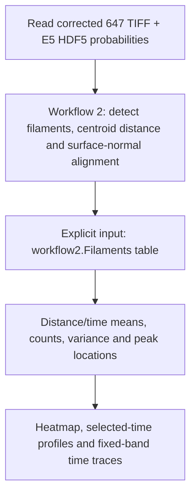

# Active Foam E5: workflow 2 measurements and alignment plots

[Editable setup](../Examples%20and%20Workflows/examples/setupActiveFoamE5.m) · [Data/analysis definitions](../Examples%20and%20Workflows/examples/farmActiveFoamE5Config.m)

This example processes **Experiment 5, frames 25–30 only**. Everything under
`O:\Session 88` is read only. Corrected 647 images supply filament observations;
the HDF5 fields supply object/structure segmentation. Corrected 560 TIFFs are
not used by this analysis, although the segmentation HDF5 filenames contain 560.



## Confirmed acquisition definitions

| Definition | Value | Interpretation |
| --- | --- | --- |
| Corrected images | `O:\Session 88\Exp 5\3 Illumination Bleach Corrected 16bit` | Read only |
| Filament filename | `t%03i_illBleachCorr16bit_647.tif` | `%03i` is acquisition frame number |
| Probability folder | `O:\Session 88\all ilastik prep files` | Read only |
| Probability filename | `t%03i_illCorr8bit_560_E5_Probabilities Stage 2.h5` | E5 segmentation |
| HDF5 dataset and source axes | `/exported_data`, `CXYZ` | Historical MATLAB HDF5 source-axis convention |
| Internal arrays | YXZ, or YXZC with channels | Rows, columns, depth, channels |
| Corrected-image spacing | `[0.55 0.55 0.7] um` | **Y, X, Z** order |
| Probability spacing | `[1.5 1.5 1.5] um` | **Y, X, Z** order |
| Input channel map | `[inside, on/wall, outside] = [3, 2, 1]` | Output category IDs are 1, 2, 3 |
| Acquisition interval | 30 seconds per frame increment | Frame 26 follows frame 25 by 30 seconds |
| Plot time origin | Frame 25 | Elapsed plotting time, not absolute acquisition start |

The time assigned to each observation is `TimeSeconds = (Frame - 25) * 30`.
Frames 25–30 therefore appear at **0, 30, 60, 90, 120, 150 seconds**.
E5's crop metadata contains `cropCorner = [5 15 1]`, `winSize = [750 735 94]`;
it does not supply timing or voxel spacing. Calibration above was confirmed by
the user. Loaded corrected volumes have size **[735 750 94] in YXZ order**.
Similar extents alone do not establish registration; inspect the saved semantic previews.

## Stage 1: workflow 2 measurements

The existing extraction settings are explicit in `farmActiveFoamE5Config`:
LoG sigma 1 intensity-grid voxel; strict threshold 20 on `-LoG`; probability
thresholds `[.33 .33 .33]`; probability opening radius 1 voxel; reference-gradient
smoothing sigma 2 intensity-grid voxels. Minimum filament length/aspect filters
remain 0, matching the existing workflow. No detection parameters were fitted
to the expected alignment pattern. Detections are not independently verified rods.

`farmProcessActiveFoamE5(c)` executes workflow 2 one frame at a time, saves each
frame independently, and logs loading, detection, reference construction and
centroid sampling. It returns a combined `workflow2.Filaments` table. Each run
has its own configuration, input-file manifest and processing log.

Distance and normal fields are produced by the existing `farmWorkflowReference`:
semantic labels are placed on the intensity grid, resampled to an isotropic
working grid with spacing `min(c.Spacing) = 0.55 um`, and passed to the existing
boundary-distance calculation. Distance is scaled to micrometers and sampled
at rounded filament centroids. Surface-normal directions use its smoothed
distance gradient with physical derivative spacing.

`BoundaryDistance` is the workflow's distance to its computational boundary:
**negative inside, positive outside, zero at that boundary**. Its exact definition
depends on segmentation and the existing boundary construction. No observed
alignment peak is used to shift this field or redefine zero. Invalid reference
locations are excluded using the workflow's validity flags, not reinterpreted
as true zero distance. This does not create independent fields for every structure.

The plotted alignment is **Order3D**, not projected Order2D:

`A = (3 * cos(theta)^2 - 1) / 2`

Here theta is the angle between the physical-space filament director and sampled
surface-normal direction. Isotropic 3D orientations have expected mean **0**;
parallel/antiparallel directions give 1, and perpendicular directions give -0.5.
Reversing either direction leaves this axial alignment unchanged.

## Stage 2: explicit handoff to plotting

```matlab
workflow2 = farmProcessActiveFoamE5(c);
plotOptions = c.AlignmentPlot;
plotOptions.OutputDirectory = fullfile(workflow2.Directory, 'alignment-plots');
alignmentReport = farmPlotActiveFoamAlignment(workflow2, plotOptions);
```

**The last line is where workflow 2 output is passed to the plotting workflow.**
Plotting reads no microscopy sources. Its data columns are:

| Quantity | Workflow 2 source |
| --- | --- |
| Distance r | `workflow2.Filaments.BoundaryDistance`, um |
| Observation time | `Frame`, converted to elapsed seconds by the formula above |
| Alignment A | `Order3D` |
| Included observation | `Selected & ReferenceValid & ReferenceDirectionValid`, finite r and A |
| Identity | `DatasetID`, `Frame`, `ObjectID` |

ObjectID identifies a detected filament within a frame. The current output does
not establish which detections across frames are the same rod or assign every
rod to a tracked structure. The plots **weight rod observations equally**, not
structures equally; they are not structure-level or longitudinal uncertainty estimates.

## Stage 3: bins, peaks and fixed bands

These are exposed exploratory choices, not validated experimental thresholds:

| Choice | Initial setting |
| --- | --- |
| Distance edges | `-20:1:30 um` |
| Time bins | One acquisition frame per bin; centers 0:30:150 s |
| Selected profile frames | 25, 27, 30 |
| Representative-peak averaging window | `[0 150] s`, inclusive acquisition centers |
| Fixed band around r* | `r* ± 1 um` |
| Interior/exterior bands | `[-10,-5)` and `[5,10) um` |
| Minimum rods for a peak candidate bin | 20 |
| Flat-profile diagnostic | Eligible maximum minus minimum <= 0.05 |
| Broad-peak diagnostic | More than one eligible bin within 10% of the maximum's magnitude |

All finite observed bins are plotted, including those with fewer than 20 rods.
The minimum count applies only to peak-location diagnostics. Peak bins are
compared at their centers; no sub-bin fitting or spatial smoothing is added.
The moving markers maximize the means over **count-qualified bins**, and can
therefore differ from the unrestricted argmax over every displayed bin. Sparse
exterior bins remain visible in the means; they are not allowed to determine
these count-qualified markers. Set MinPeakCount=1 to inspect the unrestricted
finite-bin maximum, retaining the flat/tie flags.
Ties within `1e-12`, flat profiles, and profiles with no eligible bins have no
reported moving peak location. Their candidate maximum/value and flags remain
available. Broad or distance-range-edge peaks are flagged and remain provisional.

The fixed r* maximizes the equal-time mean of bin means over the window. A
distance must have a finite mean and at least 20 observations at **every**
included time to be compared. Missing positions are excluded, not averaged over
a shorter subset. Equal spacing uses weights 1/6; irregular included times use
normalized trapezoidal weights. r* is not the average moving peak location.
If its profile is flat/tied or lacks common coverage, r* and its band are missing.

Means and counts come from individual included rows. Empty means/variances are
NaN; counts are zero. Variance uses the sample estimate with denominator `n-1`;
a single rod has a mean but no estimated sample variance. Distance bins follow
`histcounts`/`discretize` edge rules, including the final right edge. Fixed
distance bands are left-inclusive/right-exclusive. Out-of-range counts are saved.

### This run's provisional locations and band overlap

For the initial E5 run, r* is **-7.5 um**. Moving peak locations for frames
25–30 are **[-6.5, -8.5, -8.5, -8.5, -6.5, -6.5] um**. All six are flagged
as broad. These are exploratory binned maxima, not precise fitted positions.
The defined boundary remains at zero; the observed offset is retained.

The initial fixed band is therefore **[-8.5,-6.5) um**. It is contained within
the initially chosen interior band **[-10,-5) um**. Those two traces share
observations and are not independent comparisons. The exterior band is
**[5,10) um**. No band was moved after seeing the data to force an expected pattern.

## Stage 4: the three plots

| Figure | X | Y | Data |
| --- | --- | --- | --- |
| Mean heatmap | Signed distance, um | Elapsed time, s | Color = distance/time-bin mean Order3D |
| Spatial profiles | Signed distance, um | Mean Order3D | Frames 25, 27, 30; shading = rod standard deviation |
| Fixed-band traces | Elapsed time, s | Mean Order3D | Rods within each stated distance band; shading = rod standard deviation |

The heatmap overlays the moving peak position and fixed r*, with the defined
boundary at r=0 unchanged. Gray heatmap bins mean missing data. Profiles also
mark the isotropic mean and peak locations. Structural stages are **not assigned**
from this six-frame window; frame/time labels are used until stage annotations
are supplied. No spheroid/shell/expansion stage is inferred from alignment alone.

Standard deviation describes dispersion among detections. It is **not a
confidence interval** or an error bar for the precision of the mean. No
independence assumption among repeated rods/structures is used to claim precision.

## Outputs and rerunning

Outputs are under `tests/data/workflow-results/active-foam-E5-frames025-030`,
outside the read-only O: data tree. A fresh `active-foam-E5_*` folder contains:

- `input-files.csv`, `configuration.mat`, `processing.log`;
- one workflow 2 directory per frame, with measured tables and a semantic preview;
- `completed-through-frameNNN.mat` checkpoints, `workflow2-output.mat`, `workflow2-filaments.csv`;
- `alignment-plots`: three PNG/FIG figures and CSV/MAT numerical results, including
  bin counts/variance, moving peak location/value/flags, fixed-window profile,
  fixed-band traces and observation counts. `alignment-analysis.mat` retains all definitions.

To rerun just plotting, load the saved workflow 2 output; do not rerun image
processing. From the repository root after `farmSetup('IncludeExamples',true)`:

```matlab
savedWorkflow2File = fullfile(c.OutputRoot, '<actual run folder>', 'workflow2-output.mat');
saved = load(savedWorkflow2File, 'result');
workflow2 = saved.result;
workflow2.Directory = fileparts(savedWorkflow2File); % Current location after a folder move.
plotOptions = c.AlignmentPlot;
plotOptions.OutputDirectory = fullfile(workflow2.Directory, 'alignment-plots-revised');
alignmentReport = farmPlotActiveFoamAlignment(workflow2, plotOptions);
```

Choose an unused plot directory: existing outputs are never overwritten.
Source files are never modified. The new plotting tests run without O: data.
