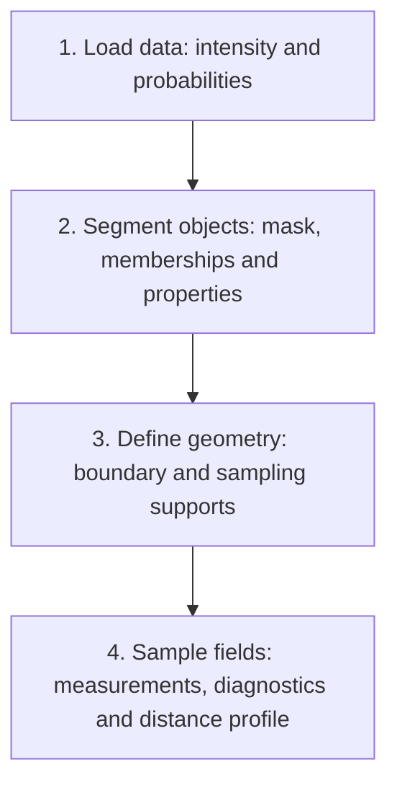

# Workflow 1: load, segment, define geometry and sample fields

[User guide](README.md) · [Editable MATLAB setup](../Examples%20and%20Workflows/examples/setupWorkflow1.m) · [Batch workflow](../Examples%20and%20Workflows/examples/farmWorkflow1Objects.m)

Run the setup's sections in order. Stop after a stage to inspect its variables.
The default example uses two synthetic objects and opens an image overlay and
distance-profile plot. It needs MATLAB R2023a and Image Processing Toolbox.
It reads no image files and writes nothing with the default execution choices.



## Setup and data descriptions

In MATLAB, first open `setupWorkflow1.m` and check `repo` in SETUP. Run SETUP
before the other sections. The script uses an explicit repository path so
individual editor sections work without relying on the current directory.

| Choice | Default | Effect |
| --- | --- | --- |
| `useSynthetic` | `true` | Uses small generated probability/intensity volumes |
| `showFigures` | `true` | Displays existing stage results |
| `savePreview` | `false` | Saves the inspected frame only when selected |
| `runBatch` | `false` | Processes selected frames only when selected |

DATA SOURCES constructs `intSrc`, `probSrc` and `experiment`: descriptions of
where data comes from and how it is calibrated. They are distinct from loaded
image values. The synthetic source loaders close over small demonstration
arrays; real sources point to files, without preloading the acquisition series.

Your Experiment 4 folders, filename patterns, axes, frame selection and spacing
remain in this section. Set `useSynthetic = false` to use them, after checking
that those files are available. The real settings retain frames `10:2:30`,
intensity spacing `[.55 .55 .7] um`, probability spacing `[1.5 1.5 1.5] um`,
and a 30-second interval per original acquisition-frame increment.

`frame = c.Frames(1)` selects the first acquisition frame for inspection.
`Frame` identifies the acquisition; `TimeIndex` selects a stored array position.
Object IDs in this example are frame-local. No tracking or ancestry is inferred.

## Stage 1: data loading

```matlab
image = farmLoadSource(experiment, 'Intensity', frame);
probabilityImage = farmLoadSource(experiment, 'Probabilities', frame);
intensity = image.Data(:, :, :, 1, 1);
probabilities = probabilityImage.Data(:, :, :, :, 1);
```

| Result | What to inspect |
| --- | --- |
| `image`, `probabilityImage` | Identity, selected channels, spatial spacing and units |
| `intensity` | One quantitative YXZ intensity volume |
| `probabilities` | A YXZC array of category probabilities |

Select one intensity channel/time point. Probability channels describe
segmented categories, not individual objects. Loading does not normalize,
register or resample the quantitative intensity values.

For real data, confirm matching origin, crop, axes and spatial registration
before proceeding. A size or extent check cannot establish registration.

## Stage 2: object segmentation and selected properties

This example retains workflow 1's probability-sum method. It sums channels
`[3 2]`, applies the strict threshold `> .6`, optionally smooths the resulting
mask on the probability grid, and resizes the mask to the intensity grid using
nearest-neighbor interpolation. Category meaning must be checked for your data.

The synthetic example disables smoothing to retain two known masks. The real
example retains the original smoothing sigma of 2 probability-grid voxels.

```matlab
foregroundProbability = sum(probabilities(:, :, :, c.ForegroundChannels), 4);
segmentationMask = foregroundProbability > c.ForegroundThreshold;
% The setup applies optional smoothing here before resizing.
mask = imresize3(segmentationMask, size(intensity), 'nearest');
objects = farmPrepareObjects(mask, identity);
properties = farmMeasureObjects(objects, c.ObjectProperties, c.MeasurementOptions);
```

| Result | Meaning |
| --- | --- |
| `foregroundProbability` | Sum of the selected category channels |
| `segmentationMask` | Foreground on the probability grid |
| `mask` | Foreground on the intensity grid |
| `objects` | Identified voxel memberships and grid metadata |
| `properties` | Requested native measurements with dataset/frame/object keys |

The setup also requests `PhysicalVolume`, calculated as voxel count multiplied
by `prod(image.Spacing)`. Native `Volume` remains a voxel count; the separate
column carries the cubed spacing unit. Change `c.ObjectProperties` without
changing geometry or sampling definitions.

Nearest-neighbor resizing changes the mask's sampling grid. It assumes the
input grids describe the same registered volume and does not correct alignment.
For a supplied mask/label matrix, replace the probability operations with your
same-grid data before `farmPrepareObjects`. In batch mode, `c.ObjectLoader`
provides that alternative; set `c.ObjectInputType = 'labels'` to preserve IDs.

## Stage 3: geometry definition

The setup requests whole-object membership and a boundary shell:

```matlab
geometry.boundary = farmGenerateGeometry(objects, 'boundary', c.GeometryOptions.boundary);
supports = struct('objects', objects, 'boundary', geometry.boundary);
```

`geometry.boundary.Records` contains per-component voxel indices with parent
object IDs. `supports` gives those locations names for queries. The same
geometry can support several independent measurements.

The boundary uses `Sigma = 1`, `LayerMean = 0`, `LayerWidth = 1`. It is a finite
selection from a smoothed distance field, not a mesh or an infinitely thin
surface. Inspect the overlay before interpreting it as a physical boundary.

The stage also defines two fields from the **combined foreground mask**:

| Field | Definition and units |
| --- | --- |
| `interiorDistance` | Distance to background, zero outside, in voxels |
| `signedDistance` | Negative inside foreground and positive outside, in voxels |

These distance transforms are isotropic voxel operations. Image spacing metadata
does not convert them into physical distances on an anisotropic grid. They do
not create independent distance fields for every object. Add skeleton support
only after installing the [local GaussDiff dependency](LOCAL-DEPENDENCY-SETUP.md).
Mesh/sheet modes remain deferred.

## Stage 4: field sampling relative to geometry

Each query explicitly names its output, field, support and statistics:

```matlab
query = farmMakeQuery('Name', 'IntensityOnboundary', ...
    'Field', 'Intensity', 'Support', 'boundary', 'Statistics', {'Mean', 'Std'});
boundaryResults = farmQueryFrame(fields, supports, query);
```

The complete setup requests intensity and interior-distance statistics on both
whole objects and boundaries. Results are attached by identity keys, rather than
assuming matching table row order.

| Result | How to access it |
| --- | --- |
| `sampling` | Full query table, including sampling diagnostics |
| `measurements` | Object properties plus requested sampling statistics |
| Boundary intensity mean | `measurements.IntensityOnboundary_Mean` |
| Selected locations | `diagnostics.IntensityOnboundary_SelectedCount` |
| Finite values used | `diagnostics.IntensityOnboundary_FiniteCount` |
| Pooled distance-bin means | `distanceProfile.Statistics.Mean` |
| Samples outside profile edges | `distanceProfile.ExcludedCounts` |

Built-in scalar statistics use finite samples; NaN and both infinities have
separate diagnostic counts. Empty geometry and fallback are distinguished.
See the [sampling topic page](reference/statistics.md).

`c.ProfileEdges = -12:2:16` explicitly selects signed-distance bins for an
additional pooled profile across the whole current volume. Set it to `[]` to
skip the profile. Bins follow `histcounts`: left edge included, right edge
excluded, except the last bin includes its final edge. This is a voxel-weighted
pooled profile, not an equal-weight average of per-object profiles. It makes no
population or ancestry policy choices.

## Display, stopping and rerunning

DISPLAY draws an intensity slice with object/boundary contours and the pooled
distance profile. It uses existing results and does not repeat measurements.

| Changed choice | Rerun |
| --- | --- |
| Source description or synthetic/real option | DATA SOURCES, then stages 1–4 |
| Acquisition frame | Stages 1–4 |
| Channels, threshold, smoothing or object properties | Stages 2–4 |
| Geometry type or shell settings | Stages 3–4 |
| Query names, fields, statistics or profile edges | Stage 4 |
| Display options | DISPLAY |

Rerun DISPLAY and selected save sections after recalculating. Settings are
written next to their operations; edit those lines in the script before running
the section. Clearing MATLAB loses the intermediate arrays. Saved result files
are not complete restart checkpoints. An old downstream table remains stale
until its stage is rerun; the example does not automatically invalidate it.

## Save and batch processing

With `savePreview = true`, SAVE CURRENT FRAME writes selected results to a new
directory under `tests/data/workflow-results`. No acquisition data is overwritten.
`c.SaveGeometry` and `c.SaveSupports` explicitly control potentially large index
outputs; both default false. MAT files contain a variable named `result`.

With `runBatch = true`, BATCH calls `farmWorkflow1Objects(c)` for `c.Frames`,
loading/processing/saving one frame at a time. `c.Verbose = true` prints progress
per frame. It starts a fresh run and recalculates the inspected frame if selected.
Older named-source and Experiment 4 configurations still work with the runner.

The returned `result` manifest has `Directory`, combined `Measurements` and
`Diagnostics`. Optional distance profiles and geometry/supports are per-frame
payloads, not automatically concatenated across time:

```matlab
saved = load(fullfile(result.Directory, sprintf('frame%03i.mat', frame)));
frameResult = saved.result;
```

Changing setup requests does not change the saved results of an earlier run.
